# StreamMix 🎥

> **Professional Cross-Platform Live Video Production & Streaming Suite**  
> 100% Native C++20 / Qt6 replica of **vMix 29** for macOS, Windows, and Linux.

[](https://en.wikipedia.org/wiki/C%2B%2B20)
[](https://www.qt.io/)
[]()
[]()
[]()
[]()

---

## 📌 Overview

**StreamMix** is a high-performance, broadcast-grade live production switcher built from the ground up in native **C++20** and **Qt6**. Designed to liberate live broadcasters, esports tournaments, and houses of worship from Windows-exclusive hardware, StreamMix delivers complete feature parity with **vMix 29** on macOS (Apple Silicon & Intel), Windows 10/11, and Linux.

The system is architected into two decoupled components:
1. **`libstreammix`** — A headless, high-throughput C++20 core engine handling video compositing, audio matrix mixing, hardware control, and multi-protocol streaming with **zero UI dependencies**.
2. **`streammix-app`** — A hardware-accelerated Qt6 desktop application providing dual Preview/Program monitors, physical T-Bar control, an 8-channel overlay stack, audio channel strips, PTZ camera controls, and Instant Replay panels.
3. **Embedded Web Controller** — A built-in HTTP/WebSocket server running on port `8088` that serves an iPad/tablet switching interface and live Telestrator with zero external dependencies.

---

## 🏗️ Architecture

```mermaid
flowchart TD
    subgraph Ingest["Capture & Ingest Layer"]
        FFmpeg["FFmpeg 7 (Cameras, RTMP, SRT, RTSP, Video Files)"]
        Zoom["Native Zoom SDK (Multi-Caller Ingest & Isolation)"]
        OMT["Open Media Transport (4K/120fps Zero-License LAN)"]
        Titles["Title Engine & Data Sources (CSV, JSON, Timers)"]
        PTZIn["PTZ Cameras (VISCA-IP, Pelco-D)"]
    end

    subgraph Core["Core Engine (libstreammix)"]
        Compositor["8-Overlay Compositor & Transition Engine"]
        AudioMixer["32-Bit Float Matrix Audio Mixer (Master, Headphone, Buses A-G)"]
        Context["Master Production Context Synchronization"]
        ReplayEngine["Instant Replay 2.0 (4-Angle Ring Buffer & Slow-Mo)"]
        PTZCtrl["PTZ Controller (Presets, Auto-Track, Tally)"]
        MidiCtrl["Hardware Control Surface (MIDI, Stream Deck, XML)"]
        ChromaKey["Studio Chroma Keyer & Despill Engine"]
        VirtualSet["Virtual Studio Sets & Dynamic Zoom"]
        PresetMgr["Project Session Persistence (.stmix / .vmix)"]
        Simulcast["MultiStreamManager (5-Destination Simulcast)"]
    end

    subgraph Output["Output & Distribution Layer"]
        VCam["Virtual Camera (Shared Memory IPC)"]
        RTMPOut["RTMP / SRT Streaming Output (YouTube, Twitch, FB)"]
        WebCtrl["Embedded Web Controller & Telestrator (Port 8088)"]
    end

    subgraph UI["Control & GUI Surfaces (streammix-app)"]
        QtApp["Native Qt6 Desktop Application"]
        PTZUI["PTZ Camera Panel Widget"]
        ReplayUI["Instant Replay 2.0 Panel Widget"]
        MobileWeb["iPad / Tablet Web Controller (HTML/JS)"]
        Surface["USB MIDI Surfaces (Akai APC Mini, Behringer X-Touch)"]
        Companion["Bitfocus Companion & Elgato Stream Deck"]
    end

    Ingest --> Compositor
    Ingest --> AudioMixer
    Ingest --> ReplayEngine
    PTZIn <--> PTZCtrl
    Context --> Compositor
    Context --> AudioMixer
    Context --> ReplayEngine
    Context --> PTZCtrl
    Context --> MidiCtrl
    Context --> ChromaKey
    Context --> VirtualSet
    Context --> PresetMgr
    Context --> Simulcast
    Compositor --> VCam
    Simulcast --> RTMPOut
    Compositor --> QtApp
    Context --> WebCtrl
    WebCtrl <--> MobileWeb
    MidiCtrl <--> Surface
    WebCtrl <--> Companion
```



---

## ⚡ Key Feature Parity (vMix 29)

### 1. Compositor Engine & Transitions
* **8 Independent Overlay Channels**: Hardware-accelerated picture-in-picture (PIP), bugs, lower thirds, and animated bugs with individual Alpha, Zoom, and Pan controls.
* **Broadcast Transitions**: Cut, Fade, Wipe (Left/Right/Up/Down), Slide, Zoom, Fly, and Stinger transitions with custom audio triggers.
* **QuickPlay ("GO")**: Instant one-click switch of any preview or background input to Program.
* **Fade to Black (FTB)**: Synchronous video and audio fade with programmable duration.
* **MultiView**: Native 2-up, 4-up, 8-up, and custom layout matrix compositing.

### 2. Pro Audio Matrix Mixer
* **32-Bit Float $48\text{ kHz}$ Processing**: Internal high-headroom DSP pipeline.
* **Complete Bus Matrix**: Master Bus, Headphones Monitoring Bus, and 7 Sub-Buses (**Bus A through Bus G**).
* **Audio Follows Video (AFV)**: Smooth automatic crossfade when video sources switch.
* **Mix-Minus Routing**: Automatically isolates remote callers (Zoom, WebRTC) from their own return audio with zero echo.
* **Channel Controls**: Input Gain ($-60\text{ dB}$ to $+12\text{ dB}$), Stereo Pan, Mute, Solo, and Delay compensation ($0\text{--}1000\text{ ms}$).

### 3. Remote Ingest & Zero-License LAN Video
* **Native Zoom SDK**: Direct C++ integration without capture cards. Pulls isolated active speakers or gallery views with individual Mix-Minus audio return.
* **Open Media Transport (OMT)**: Zero-license 4K $120\text{ fps}$ LAN video transport. Ultra-low latency, mDNS automated discovery, and hardware packetization.
* **Zero-Copy Virtual Camera**: Shared-memory IPC ring buffer visible as a native webcam in Zoom, Microsoft Teams, Google Meet, and OBS.

### 4. Dynamic Titles & Data Sources
* **Live Data Binding**: Bind title text fields to dynamic data sources with `{DataSource.Column}` syntax.
* **Data Sources**: CSV / TSV files, JSON REST API endpoints, and precision countdown timers.
* **Templates**: Lower Thirds, Sports Scoreboards with dynamic clocks, and animated crawling news tickers.

### 5. Instant Replay 2.0
* **Multi-Camera Ring Buffer**: Ingest up to 4 synchronized camera feeds into a continuous circular memory buffer ($10\text{--}120\text{ seconds}$).
* **Variable Speed Slow-Motion**: Smooth playback from $10\%$ to $200\%$ speed.
* **Playheads**: 4 independent playheads with Mark In / Mark Out tagging.
* **Quad-Cam Replay Bus**: Composite 4-angle replay view output with instant clip extraction and saving.

### 6. PTZ Camera Control
* **Dual Protocols**: VISCA-over-IP (UDP/TCP) and Pelco-D serial/IP support.
* **Camera Actions**: 8-way directional Pan/Tilt, variable-speed Zoom, and manual/auto Focus.
* **Preset Grid**: Store and recall 16 camera position presets per camera with smooth positioning.
* **Program Tally Auto-Tracking**: Automatically recalls a designated close-up preset when a PTZ camera is cut to Program.
* **Two-Way Tally Feedback**: Red (Program), Green (Preview), and Off tally states.

### 7. Studio Chroma Keyer & Virtual Sets
* **Broadcast Chroma Keying**: Real-time Green Screen and Blue Screen extraction with adjustable similarity and edge feathering.
* **Spill Suppression (Despill)**: Automatic neutral despill suppression that eliminates green/blue reflection on talent hair and clothing.
* **Multi-Layer Virtual Sets**: Studio background backdrop, keyed presenter layer with placement scaling, studio desk/podium occlusion, and mirror floor reflections.
* **Virtual Camera Zoom**: Smooth dynamic camera pan and zoom transitions between studio camera angles with cubic easing.

### 8. Multi-Destination Live Streaming (Simulcast)
* **5 Concurrent Streaming Endpoints**: Stream simultaneously to YouTube Live, Twitch, Facebook Live, and custom RTMP/SRT servers.
* **Independent Encoding**: Per-stream video/audio bitrates, resolutions, and audio bus selections (e.g. Clean feed on Stream 1, commentary on Stream 2).
* **Live Telemetry**: Real-time combined bandwidth (Mbps), total sent frames, dropped frames, and stream uptime.

### 9. Project Preset Persistence (`.stmix`)
* Save and restore entire production configurations (inputs, video URLs, audio bus routing, overlay bindings, and PTZ camera addresses) to `.stmix` (JSON) or `.vmix` (XML) files.

---

## 📱 Web Controller & Telestrator (Port 8088)

StreamMix features an embedded high-speed HTTP and WebSocket server running on port `8088`. Any iPad, tablet, or smartphone on the local network can control the switcher without installing third-party apps:

```
http://<switcher-ip>:8088
```

* **Live Video Switching**: Touch-friendly Cut, Fade, QuickPlay GO, and T-Bar fader.
* **Input Deck**: Real-time preview thumbnails, live Program (Red) and Preview (Green) tally indicators.
* **Overlay Triggers**: Toggle Overlays 1 through 8 with live status indicators.
* **Audio Mixer**: Remote touch volume sliders, mute, solo, and AFV controls.
* **HTML5 Telestrator**: Draw live graphics, circles, arrows, and tactical markup on an iPad screen, composited in real time over **Overlay 8** on the Program feed.

---

## 🎛️ Control Surfaces & vMix 29 REST / XML API

### Hardware MIDI Surfaces
StreamMix connects natively to USB MIDI control surfaces with two-way hardware LED feedback:
* **Akai APC Mini / APC40**: 8x8 button clip matrix mapped to Program/Preview input selection with Red/Green LED illumination, faders mapped to input and Master volumes.
* **Behringer X-Touch Mini**: Rotary encoders for volume and pan, motorized master fader driving the physical T-Bar.
* **Novation Launchpad**: Full color RGB feedback for input tally and overlay state.

### vMix 29 REST API Emulation
StreamMix implements the standard vMix HTTP API, allowing full compatibility with **Bitfocus Companion**, **Elgato Stream Deck**, and custom Crestron/Q-SYS controllers:

```http
GET http://localhost:8088/api?Function=Cut
GET http://localhost:8088/api?Function=Fade&Duration=500
GET http://localhost:8088/api?Function=PreviewInput&Input=2
GET http://localhost:8088/api?Function=ActiveInput&Input=1
GET http://localhost:8088/api?Function=OverlayInput1&Input=3
GET http://localhost:8088/api?Function=SetFader&Value=128
GET http://localhost:8088/api?Function=FadeToBlack
GET http://localhost:8088/api?Function=StartStreaming
GET http://localhost:8088/api?Function=SetVolume&Input=1&Value=85
```

### vMix XML Polling Document
Bitfocus Companion and polling control surfaces can poll `http://localhost:8088/api` for real-time switcher state:
```xml
<vmix>
    <version>29.0.0.1</version>
    <edition>Pro</edition>
    <active>1</active>
    <preview>2</preview>
    <tbar>0.000</tbar>
    <fadeToBlack>False</fadeToBlack>
    <streaming>True</streaming>
    <recording>False</recording>
    <inputs>
        <input key="1" number="1" type="Camera" title="Stage Camera" state="Running" position="0" duration="0" loop="False" muted="False" volume="100" balance="0" solo="False" audiobuses="M">Stage Camera</input>
    </inputs>
    <overlays>
        <overlay number="1" active="False"/>
        <overlay number="8" active="False"/>
    </overlays>
</vmix>
```

---

## 🚀 Building & Running

### Prerequisites
* **C++ Compiler**: Apple Clang 15+, GCC 13+, or MSVC 2022 (C++20 standard required)
* **CMake**: Version 3.27 or higher
* **Qt6**: Core, Gui, Widgets, OpenGL, OpenGLWidgets, Network, Multimedia
* **FFmpeg 7**: `libavcodec`, `libavformat`, `libavutil`, `libswscale`, `libswresample`, `libavdevice`
* **Audio**: PortAudio 2.0
* **Network**: libsrt (optional)

### Build Instructions

```bash
# Clone the repository
git clone https://github.com/<owner>/StreamMix.git
cd StreamMix

# Configure with CMake
cmake -B build -DCMAKE_BUILD_TYPE=Release

# Compile all targets
cmake --build build --config Release -j$(nproc 2>/dev/null || sysctl -n hw.logicalcpu)

# Launch StreamMix
./build/bin/StreamMix
```

### Running Test Suites Directly (Clang / GCC)
StreamMix includes comprehensive standalone integration tests that can be built and executed directly:

```bash
# Run Master Integration Suite (Validates all 10 core subsystems)
clang++ -std=c++20 -Ilibstreammix/include -Ilibstreammix/src \
    libstreammix/src/core/context.cpp \
    libstreammix/src/core/data_source.cpp \
    libstreammix/src/core/preset_manager.cpp \
    libstreammix/src/capture/source.cpp \
    libstreammix/src/capture/title_source.cpp \
    libstreammix/src/compositor/compositor.cpp \
    libstreammix/src/audio/audio_mixer.cpp \
    libstreammix/src/control/control_surface.cpp \
    libstreammix/src/control/ptz_controller.cpp \
    libstreammix/src/replay/instant_replay.cpp \
    tests/test_master_suite.cpp \
    -o /tmp/test_master && /tmp/test_master

# Run Chroma Key, Virtual Set & Simulcast Test Suite
clang++ -std=c++20 -Ilibstreammix/include -Ilibstreammix/src \
    libstreammix/src/compositor/chroma_key.cpp \
    libstreammix/src/compositor/virtual_set.cpp \
    libstreammix/src/output/rtmp_output.cpp \
    libstreammix/src/output/stream_manager.cpp \
    tests/test_chroma_virtual_set.cpp \
    -o /tmp/test_chroma && /tmp/test_chroma
```

---

## 📦 Standalone Packaging

### macOS (`.app` + `.dmg`)
Creates a notarizable, universal DMG with bundled Qt frameworks:
```bash
./scripts/package_macos.sh Release
# Output: dist/macos/StreamMix-1.0.0.dmg
```

### Windows (`.msi` Installer)
Packages all DLL dependencies via `windeployqt` and builds an MSI via WiX Toolset:
```powershell
.\scripts\package_windows.ps1 -BuildType Release -Arch x64
# Output: dist\windows\StreamMix-1.0.0-x64.msi
```

### Linux (`.AppImage`)
Packages a standalone AppImage portable across all modern distributions:
```bash
./scripts/package_linux.sh Release
# Output: dist/linux/StreamMix-1.0.0-x86_64.AppImage
```

---

## 🔄 CI/CD Pipeline

The project includes an enterprise-grade GitHub Actions workflow (`.github/workflows/build.yml`) that runs on every push and pull request:
1. Matrix builds on **macOS 14**, **Windows Server 2022**, and **Ubuntu 24.04**.
2. Executes all automated test suites to ensure 100% assertion pass rates.
3. Automatically packages and publishes universal `.dmg`, `.msi`, and `.AppImage` deliverables as GitHub Releases whenever a `v*` tag is pushed.

---

## 📄 License
StreamMix Live Production Software. All rights reserved.
